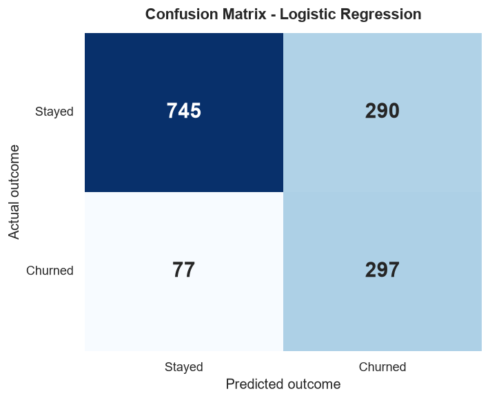
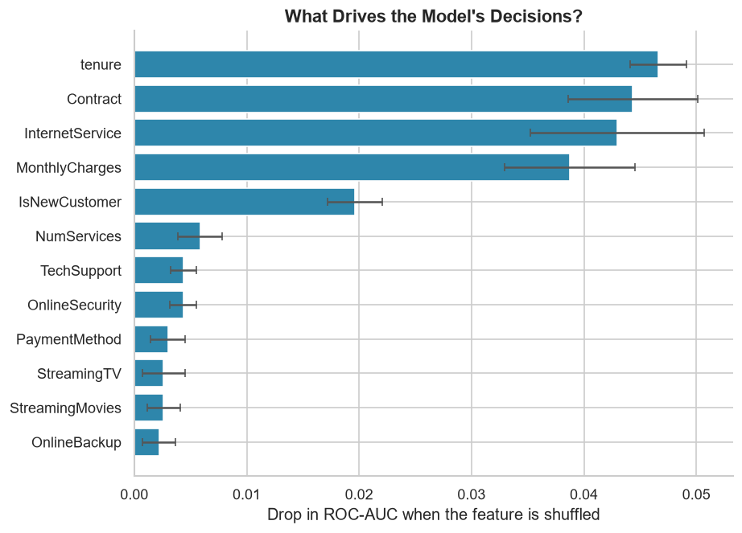

# Customer Churn Prediction

### An end-to-end data science project for telecom retention

**Prepared by:** Yugendra Pujari
**Programme:** Avishkarana Andhra Summer Internship (Data Science)
**Host organisation:** Bharat Care Life Line Foundation (ZERO P4 Poverty)
**Date:** Summer 2026

---

## Abstract

Customer churn is a direct threat to revenue in subscription businesses. This project builds
a machine learning system that predicts which telecom customers are likely to leave, explains
the factors behind each prediction, and translates the result into retention actions. The
dataset contains 7,043 customers and 21 attributes. After cleaning, exploratory analysis and
feature engineering, three models were compared using stratified five-fold cross-validation.
Logistic Regression achieved the best cross-validated ROC-AUC (0.847) and, on a held-out test
set of 1,409 customers, reached a ROC-AUC of 0.846 and a recall of 79.4%. The model was
deployed in a Streamlit application that provides a risk score, the contributing factors and a
what-if simulator for contract and service changes. The main finding is that commitment and
perceived support matter more than feature count: month-to-month customers churn at 42.7%,
versus 2.8% on two-year contracts.

---

## 1. Introduction

Acquiring a new customer is generally more expensive than retaining an existing one, so a
small reduction in churn can have a large effect on revenue. Retention teams, however, cannot
contact every customer. They need a ranked list of who is most at risk, an explanation of why,
and a sense of which intervention might help.

This project addresses three questions:

1. **Who is likely to churn?** Build a model that estimates churn probability from customer
   behavior and account data.
2. **Why?** Identify the features that drive the prediction and express them in business terms.
3. **What can we do?** Turn the model into a tool that lets a retention team explore
   counterfactual scenarios.

The scope is a decision-support system, not an automatic replacement for human judgment.

---

## 2. Dataset

The project uses the public IBM Telco Customer Churn dataset.

| Property | Value |
|---|---|
| Rows | 7,043 customers |
| Raw columns | 21 |
| Target | `Churn` (Yes = 1, No = 0) |
| Churn rate | 26.5% |
| Features | Demographics, services, contract, billing, charges, tenure |
| Missing values | 11 blanks in `TotalCharges`, all customers with tenure 0 |

The target is imbalanced: 73.5% of customers stayed and 26.5% churned. This makes accuracy a
misleading metric and motivates the use of ROC-AUC, recall and precision.

`customerID` was removed because it is a random identifier with no business meaning. The blank
`TotalCharges` values were converted to numeric and filled with the customer's monthly charge,
which is a sensible estimate for a customer with no billing history.

---

## 3. Methodology

### 3.1 Exploratory data analysis

The exploratory analysis focused on differences between churners and customers who stayed.
Key findings:

- **Contract:** month-to-month 42.7%, one year 11.3%, two year 2.8%.
- **Tenure:** churners average 18.0 months; customers who stayed average 37.6 months.
- **Internet service:** fiber optic 41.9%, DSL 19.0%, no internet 7.4%.
- **Payment method:** electronic check 45.3%, mailed check 19.1%, bank transfer 16.7%,
  credit card 15.2%.
- **Support and security:** customers without tech support or online security churn at
  roughly 42%, versus about 15% with those services.
- **Monthly charges:** churners pay $74.44 on average; customers who stayed pay $61.27.

### 3.2 Feature engineering

Three features were added:

- `NumServices`: the number of active services, capturing the breadth of the relationship.
- `AvgMonthlySpend`: total charges divided by tenure, capturing the realized monthly spend.
- `IsNewCustomer`: a flag for tenure of six months or less, capturing the high-risk onboarding
  window.

### 3.3 Preprocessing

Numeric features were median-imputed and standard-scaled. Categorical features were
most-frequent-imputed and one-hot encoded. All preprocessing was placed inside a scikit-learn
`Pipeline`, so it was fitted only on training folds and is applied identically at prediction
time. This prevents data leakage and training-serving skew.

### 3.4 Models and validation

The data was split into 80% training (5,634 rows) and 20% test (1,409 rows), stratified by the
target. Three models were compared with stratified five-fold cross-validation on the training
set:

- Logistic Regression with balanced class weights.
- Random Forest with 400 trees, a maximum depth of 10 and balanced subsampling.
- Histogram Gradient Boosting with 300 iterations.

The model with the highest cross-validated ROC-AUC was selected. The test set was used once,
after selection, for the final evaluation.

---

## 4. Results

### 4.1 Model comparison

| Model | CV ROC-AUC | Test ROC-AUC | Recall | Precision | F1 |
|---|---:|---:|---:|---:|---:|
| **Logistic Regression** | **0.847** | **0.846** | **79.4%** | 50.6% | 0.618 |
| Random Forest | 0.846 | 0.841 | 74.1% | 54.6% | 0.629 |
| Gradient Boosting | 0.827 | 0.826 | 50.3% | 60.5% | 0.549 |

Logistic Regression was selected for three reasons: it had the highest cross-validated
ROC-AUC, the highest recall, and the simplest interpretation. Random Forest had a slightly
higher test F1, but it caught five percentage points fewer churners. On a dataset of this
size, the additional complexity did not improve ranking quality.

### 4.2 Test-set performance

At a threshold of 0.50:

- Accuracy: 74.0%
- Precision: 50.6%
- Recall: 79.4%
- F1: 0.618
- ROC-AUC: 0.846
- PR-AUC: 0.653

The confusion matrix contains 745 true negatives, 290 false positives, 77 false negatives and
297 true positives. In business terms, the model caught 297 of 374 customers who actually
churned and missed 77. It also flagged 290 customers who would have stayed.



### 4.3 The accuracy trap

Because 73.5% of customers stayed, a model that predicts "everyone stays" would be 73.5%
accurate while catching zero churners. The proposed model has almost the same accuracy
(74.0%) but catches 79.4% of churners. Accuracy is therefore not a useful primary metric for
this problem. ROC-AUC and recall better reflect the business objective.

### 4.4 Interpretation

Permutation importance on the test set identified the following top drivers:

1. Tenure
2. Contract type
3. Internet service
4. Monthly charges
5. New-customer flag
6. Number of services
7. Tech support
8. Online security
9. Payment method
10. Streaming TV

These results are consistent with the exploratory analysis and support the retention
recommendations in Section 5.



---

## 5. Recommendations

1. **Prioritize the first six months.** Churn is concentrated in the first year, so build a
   structured onboarding programme with check-ins at weeks 2, 6 and 12.
2. **Convert month-to-month customers.** Offer a small incentive to move to a one-year or
   two-year contract at renewal. The observed churn difference is 42.7% versus 2.8%.
3. **Bundle support and security.** Package tech support and online security into onboarding
   for internet customers. Customers without these services churn at roughly 42%, versus
   about 15% with them.
4. **Encourage automatic payments.** Electronic-check payers churn at 45.3%, versus about 15%
   for automatic payment methods.

These recommendations are based on associations in observational data. They should be
validated with controlled A/B tests before being scaled.

---

## 6. Limitations and future work

**Limitations**

- The dataset comes from one company and one period, so transferability is uncertain.
- The analysis is observational; the model does not establish causal effects.
- The 0.50 threshold is a neutral default, not a cost-optimized business decision.
- Customer lifetime value, competitor data and market conditions are not included.
- The dataset is not recent, so behavior may have shifted.

**Future work**

- Add SHAP explanations for per-customer reasoning.
- Monitor data drift and retrain on a regular schedule.
- Run A/B tests on the recommended retention offers.
- Add customer lifetime value so retention spending follows profit.
- Integrate the risk score into the CRM workflow.

---

## 7. Conclusion

This project delivered a complete churn prediction workflow: data cleaning, exploratory
analysis, feature engineering, model comparison, evaluation and deployment. The selected
Logistic Regression model achieved a ROC-AUC of 0.846 on unseen data and caught 79.4% of
customers who actually churned. The Streamlit application converts the model into a practical
tool that shows risk, explains the drivers and simulates retention scenarios. The analysis
shows that commitment and support are stronger signals than the number of subscribed
services, which gives the business a clear place to start.

---

## Appendix: Reproducing the project

```powershell
pip install -r requirements.txt
python src/train.py
streamlit run app.py
```

| File | Purpose |
|---|---|
| `src/train.py` | Cleaning, EDA, feature engineering, training and evaluation |
| `app.py` | Streamlit live demo |
| `models/churn_model.joblib` | Saved preprocessing + model pipeline |
| `reports/metrics.json` | All model metrics |
| `reports/figures/` | Charts used in the report and presentation |
| `slides/Customer_Churn_Prediction_Review.pptx` | Presentation deck with speaker notes |

---

## References

1. IBM. *Telco Customer Churn* dataset. IBM Business Analytics sample data.
2. scikit-learn developers. *scikit-learn: Machine Learning in Python*.
3. Streamlit. *Streamlit documentation*.
